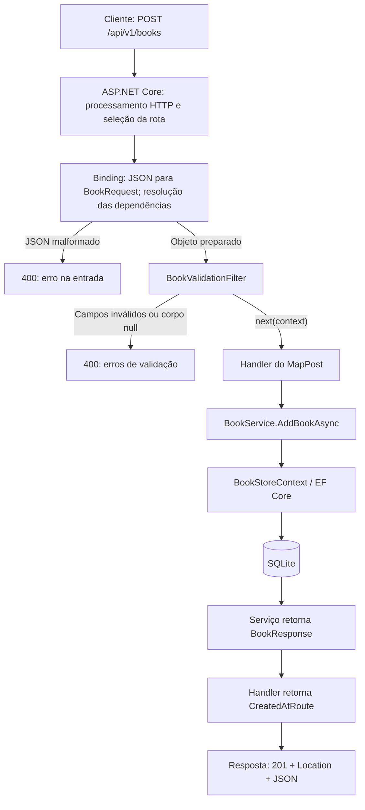

# Como explicar Minimal APIs usando a BookStore

Roteiro de 25 minutos para quem conhece classes, métodos, interfaces e o básico de `Task` em C#. Objetivo: conseguir acompanhar uma requisição HTTP pelo projeto e explicar de onde vêm os parâmetros, quem executa a operação e como a resposta é construída.

## 1. Escopo fechado

| Tempo | Assunto | O que a pessoa deve conseguir explicar |
| --- | --- | --- |
| 0–3 min | HTTP e endpoint | Método + caminho escolhem a operação; status e corpo comunicam o resultado. |
| 3–6 min | Inicialização | Serviços e rotas são registrados antes de atender requisições. |
| 6–10 min | Handler e parâmetros | JSON, rota e injeção de dependência têm origens diferentes. |
| 10–16 min | Um POST completo | Binding → filtro → handler → serviço → banco → resposta. |
| 16–20 min | Falhas e demais operações | Distinguir `400`, `404`, `201` e `204`; relacionar GET, PUT e DELETE ao mesmo fluxo. |
| 20–25 min | Demonstração | Criar, consultar, rejeitar dados inválidos e excluir um livro. |

Inclua `async/await` apenas para entender a espera pela operação. Apresente o middleware de erros e a migration pelo papel que cumprem. Deixe autenticação, autorização, CORS, versionamento avançado, repositórios, arquitetura em camadas, otimização de consultas e detalhes de concorrência para outra explicação.

Esse recorte é uma proposta didática para este projeto. A documentação oficial sustenta os conceitos; ela não estabelece uma duração ou um currículo único.

## 2. Comece pelo menor exemplo

Minimal API é uma maneira de construir endpoints HTTP no ASP.NET Core associando rotas diretamente a funções, sem precisar criar controllers para esses endpoints.

```csharp
var builder = WebApplication.CreateBuilder(args);
var app = builder.Build();

app.MapGet("/hello", () => "Olá!");

app.Run();
```

Este é um exemplo isolado para explicar a ideia; a rota `/hello` não foi adicionada à BookStore.

`MapGet` associa o método GET e o caminho `/hello` à função `() => "Olá!"`. Essa função é o **handler**: o código executado para atender a requisição correspondente. Endpoint é a operação HTTP exposta; handler é a função que a atende.

Fala sugerida: “Quando alguém faz GET nesse endereço, o ASP.NET Core encontra a função cadastrada, executa e escreve a resposta HTTP.”

Referência: [visão geral e roteamento das Minimal APIs](https://learn.microsoft.com/en-us/aspnet/core/fundamentals/minimal-apis?view=aspnetcore-8.0&preserve-view=true).

## 3. Separe dois momentos: iniciar e atender

Abra [Program.cs](../src/BookStore.Api/Program.cs:7).

Na **inicialização**, o programa lê configurações, registra os objetos que poderá fornecer, configura o processamento HTTP e cadastra as rotas. No ambiente Development, também aplica as migrations antes de começar a atender. Isso prepara o banco e não acontece em cada POST.

```csharp
builder.Services.AddDbContext<BookStoreContext>(options => options.UseSqlite(connection.ToString()));
builder.Services.AddScoped<IBookService, BookService>();

var app = builder.Build();
app.UseExceptionHandler();
app.UseStatusCodePages();

// Outras configurações do projeto foram omitidas neste recorte.
app.MapBookEndpoints();
app.Run();
```

`AddScoped` registra como fornecer `IBookService`: usando `BookService`. Dentro do escopo normal de uma requisição, a instância é reutilizada quando solicitada. O contexto do EF Core também é registrado com esse tempo de vida por padrão. O container cria os objetos quando necessários e administra seu descarte.

`MapBookEndpoints()` é uma extensão criada por nós para organizar o código; ela chama os métodos de mapeamento em outro arquivo. Cadastrar uma rota não executa seu handler. `app.Run()` inicia a aplicação e mantém o processo atendendo até seu encerramento.

Durante **cada requisição**, o ASP.NET Core seleciona o endpoint, prepara os parâmetros e executa o fluxo correspondente. O `Program.cs` inteiro não roda novamente.

Middleware é uma etapa do processamento HTTP que pode envolver o restante do fluxo. Aqui, `UseExceptionHandler` trata exceções não resolvidas e `UseStatusCodePages` pode preencher respostas de erro sem corpo. O roteamento e a execução dos endpoints também fazem parte da infraestrutura do ASP.NET Core.

Referência: [injeção de dependência e tempos de vida](https://learn.microsoft.com/en-us/aspnet/core/fundamentals/dependency-injection?view=aspnetcore-8.0).

## 4. Leia um endpoint real

Abra [BookEndpoints.cs](../src/BookStore.Api/Endpoints/BookEndpoints.cs:11):

```csharp
var books = app.MapGroup("/api/v1/books").WithTags("Books");

books.MapPost("/", async (BookRequest request, IBookService service, CancellationToken cancellationToken) =>
{
    var book = await service.AddBookAsync(request, cancellationToken);
    return TypedResults.CreatedAtRoute(book, "GetBookById", new { id = book.Id });
}).AddEndpointFilter<BookValidationFilter>()
    .ProducesValidationProblem().WithSummary("Cadastrar livro");
```

`MapGroup` compartilha o prefixo entre as rotas. Com `MapPost("/", ...)`, o endpoint atende POST em `/api/v1/books`, aceitando também a barra final. `WithTags` e `WithSummary` organizam a documentação.

Leia a expressão `async (...) => { ... }` como uma função que recebe parâmetros e pode aguardar operações assíncronas. Explique a finalidade antes da sintaxe.

| Parâmetro | De onde vem neste projeto |
| --- | --- |
| `BookRequest request` | Do corpo JSON, convertido para o contrato C#. |
| `IBookService service` | Do container de injeção de dependência configurado na inicialização. |
| `CancellationToken cancellationToken` | Do contexto da requisição, permitindo propagar seu cancelamento. |
| `Guid id`, nos endpoints de item | Do segmento `{id:guid}` da URL. |

Essa preparação dos argumentos é chamada de **parameter binding**. O cliente envia o JSON e o ID da rota quando necessário; ele não envia um `BookService` nem um `CancellationToken` no JSON.

O `/v1` é um prefixo literal neste projeto. Não existe negociação automática de versões configurada.

## 5. Acompanhe a criação de um livro

Requisição de exemplo:

```http
POST /api/v1/books
Content-Type: application/json

{
  "title": "Dom Casmurro",
  "author": "Machado de Assis",
  "description": "Romance brasileiro.",
  "category": "Romance",
  "language": "Português",
  "totalPages": 256
}
```

O diagrama mostra o caminho de uma requisição POST e suas saídas de validação; não representa todos os componentes internos do servidor.



### A. Entrada: JSON se torna um objeto

O ASP.NET Core lê o corpo JSON e prepara um `BookRequest`. JSON é o formato que trafega na rede; `BookRequest` é o tipo usado dentro do programa.

JSON sintaticamente válido ainda pode conter dados inválidos. Por exemplo, `totalPages: 0` é um número válido em JSON, mas viola nossa regra de quantidade positiva de páginas.

### B. Filtro: os dados podem continuar?

Abra [BookValidationFilter.cs](../src/BookStore.Api/Endpoints/BookValidationFilter.cs:10) e [BookRequest.cs](../src/BookStore.Api/Contracts/BookRequest.cs:8).

O filtro executa a validação dos atributos `[Required]`, `[StringLength]` e `[Range]` com `Validator.TryValidateObject`. Se houver erros, devolve `400` com Problem Details. Caso contrário, chama `next(context)` para continuar até o handler.

Neste projeto .NET 8, colocar `[Required]` no contrato não basta para executar essa validação automaticamente em Minimal APIs: o filtro é quem a aciona. `.ProducesValidationProblem()` descreve uma resposta possível para a documentação; não valida o objeto.

Quando o filtro rejeita a entrada, o handler não chama `AddBookAsync` e não há gravação do livro. A resolução das dependências pode já ter ocorrido antes disso.

Referência: [filtros e interrupção do fluxo de um endpoint](https://learn.microsoft.com/en-us/aspnet/core/fundamentals/minimal-apis/min-api-filters?view=aspnetcore-8.0).

### C. Handler: encaminhar a operação

O handler chama `service.AddBookAsync(request, cancellationToken)`. Ele conhece HTTP e escolhe a resposta. O serviço realiza a operação do catálogo.

`await` aguarda a conclusão antes de usar o resultado. Ele não transforma a sequência em operações paralelas. O projeto propaga o token até as operações do EF Core; o cancelamento efetivo depende da operação e do provedor.

### D. Serviço: preparar e persistir

Abra [BookService.cs](../src/BookStore.Api/Services/BookService.cs:22):

```csharp
var book = new Book { Id = Guid.NewGuid() };
Apply(request, book);
context.Books.Add(book);
await context.SaveChangesAsync(cancellationToken);
return ToResponse(book);
```

O serviço gera o ID, copia os campos e remove espaços nas extremidades dos textos. `Add` marca a entidade como nova no contexto; `SaveChangesAsync` realiza a gravação. Só depois o serviço devolve o contrato de resposta. A leitura com `Guid.NewGuid()` gera um identificador; não consulta o banco.

`BookStoreContext` é a ponte de acesso ao banco usando EF Core. O provedor SQLite executa os comandos necessários. Migration descreve uma alteração versionada do esquema, como criar a tabela; não é a operação de cadastrar um livro.

| Tipo | Papel neste fluxo |
| --- | --- |
| `BookRequest` | Dados aceitos do cliente. |
| `Book` | Entidade que o EF Core mapeia para a tabela. |
| `BookResponse` | Dados devolvidos ao cliente, incluindo o ID gerado. |

Referência: [inserção e SaveChanges no EF Core](https://learn.microsoft.com/en-us/ef/core/saving/basic).

### E. Saída: objeto se torna resposta HTTP

O serviço devolve `BookResponse`. O handler usa `CreatedAtRoute` para produzir `201 Created`, incluir o corpo e montar o cabeçalho `Location` com a rota nomeada `GetBookById`.

O framework executa esse resultado e serializa o corpo para JSON. `CreatedAtRoute` não executa uma segunda consulta nem redireciona automaticamente o cliente. O cliente pode usar o endereço retornado para consultar o livro.

Exemplo ilustrativo, com um ID fictício:

```http
HTTP/1.1 201 Created
Location: http://localhost:5043/api/v1/books/11111111-1111-1111-1111-111111111111
Content-Type: application/json

{
  "id": "11111111-1111-1111-1111-111111111111",
  "title": "Dom Casmurro",
  "author": "Machado de Assis",
  "description": "Romance brasileiro.",
  "category": "Romance",
  "language": "Português",
  "totalPages": 256
}
```

Referência: [respostas HTTP e TypedResults](https://learn.microsoft.com/en-us/aspnet/core/fundamentals/minimal-apis/responses?view=aspnetcore-8.0).

## 6. Transfira o raciocínio para as outras operações

| Requisição | O que muda no fluxo do projeto | Resultado esperado |
| --- | --- | --- |
| GET `/api/v1/books` | Sem corpo e sem filtro de BookRequest; consulta e projeta os livros. | `200`, inclusive com `[]`. |
| GET `/api/v1/books/{id}` | O ID vem da rota; serviço procura o livro. | `200` ou `404`. |
| PUT `/api/v1/books/{id}` | ID da rota + corpo validado; atualiza todos os campos do livro existente. | `200`, `400` ou `404`. |
| DELETE `/api/v1/books/{id}` | Serviço usa `ExecuteDeleteAsync`; não usa `SaveChangesAsync` nesse caminho. | `204` sem corpo ou `404`. |

Um texto que não é GUID em `{id:guid}` não corresponde a essa rota e resulta em `404` neste projeto. Um GUID válido sem livro também resulta em `404`, mas depois de consultar o catálogo. Método não permitido pode produzir `405`; não é necessário aprofundar essa situação na primeira demonstração.

Uma falha inesperada pode produzir `500` pelo tratamento global. Ela difere de entrada inválida (`400`) ou recurso ausente (`404`).

## 7. Demonstração em cinco minutos

Inicie a aplicação a partir da raiz do projeto:

```bash
dotnet run --project src/BookStore.Api --launch-profile http
```

Use o [Swagger](http://localhost:5043/swagger/index.html) ou o arquivo [BookStore.Api.http](../src/BookStore.Api/BookStore.Api.http).

1. Execute GET da coleção. Mostre que o resultado é uma lista, possivelmente vazia.
2. Envie o POST válido. Mostre `201`, o `id` gerado e `Location`.
3. Use esse ID no GET de item. Mostre `200` e o mesmo livro.
4. Repita o POST alterando apenas `totalPages` para `0`. Mostre `400` e os erros por campo; confira que não criou outro livro.
5. Exclua o livro criado. Mostre `204`; consulte o mesmo ID novamente para obter `404`.

Se estiver apresentando no depurador, coloque breakpoints no filtro, na chamada do serviço dentro do handler e em `SaveChangesAsync`. No POST válido, percorra os três. No POST com páginas inválidas, mostre a saída antecipada do filtro.

O Swagger é uma interface que envia requisições e mostra a descrição OpenAPI. A API também pode ser chamada por curl, aplicações web, aplicativos móveis e testes automatizados.

## 8. Fechamento e checagem de entendimento

Fala sugerida:

> “Uma Minimal API liga um método e uma rota HTTP a uma função C#. No nosso cadastro, o framework transforma o JSON em BookRequest e fornece o serviço registrado. O filtro valida, o handler chama a operação, o serviço salva pelo EF Core e o handler devolve 201 com o livro e sua localização.”

Pergunte antes de encerrar:

- **Quem cria o `BookService`?** O container de injeção, a partir do registro em `Program.cs`.
- **Quando o livro é gravado no POST?** Em `SaveChangesAsync`, após a validação.
- **Quem escolhe `201`?** O handler, usando `TypedResults.CreatedAtRoute`.
- **O que acontece com páginas iguais a zero?** O filtro devolve `400` e o handler não cadastra o livro.
- **É necessário usar EF Core e uma interface de serviço para ter Minimal API?** Não. São escolhas de organização e persistência deste projeto. O núcleo é o mapeamento de endpoints para handlers.

Se a pessoa conseguir prever esses cinco comportamentos e localizar suas causas no código, o objetivo básico foi atingido.
